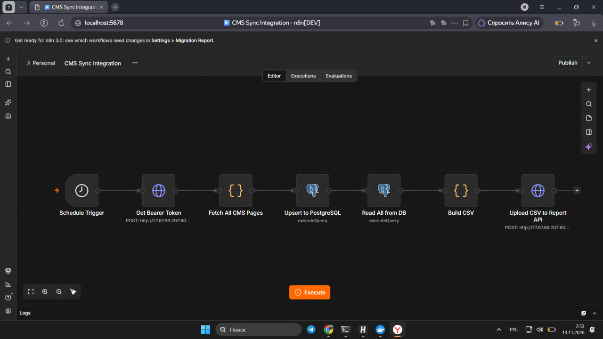
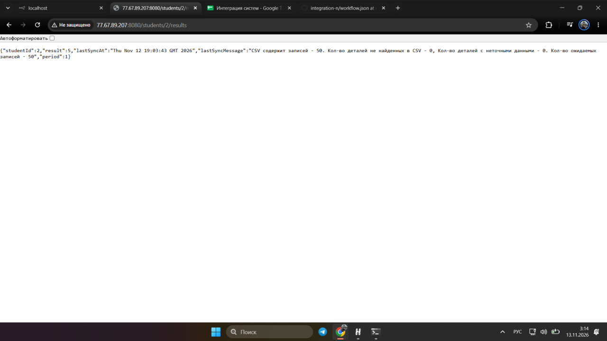

# Работа по дисциплине «Интеграция систем».  
Реализовано с использованием **n8n** и **PostgreSQL**.

Спецификация API: http://77.67.89.207:8080/swagger-ui/index.html

## Workflow

## Результат

Проверка оценки: http://77.67.89.207:8080/students/2/results

- **Student ID:** 2
