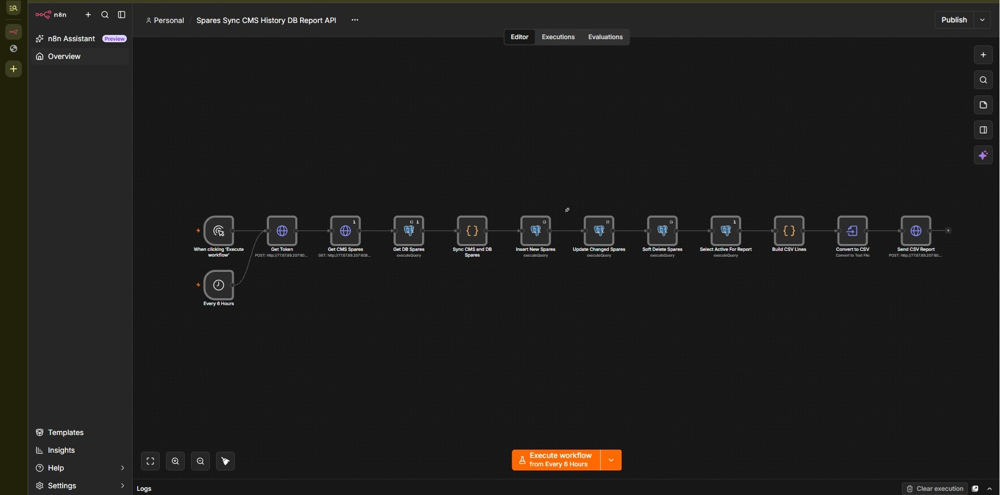
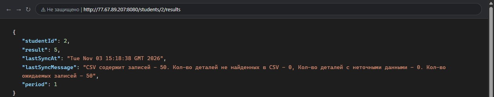

# Синхронизация деталей CMS, БД исторических данных и Report API

Курсовая работа по дисциплине «Интеграция систем». Реализовано с использованием n8n и PostgreSQL.

Спецификация API: http://77.67.89.207:8080/swagger-ui/index.html

## Workflow

1. **Get Token** — обращается к эндпоинту `/auth/token` и получает Bearer токен для Report API (логин и пароль берутся из переменных окружения `.env`).
2. **Get CMS Spares** — выгружает остатки деталей из `/cms/spares` с постраничной пагинацией, пока не получит пустой ответ.
3. **Get DB Spares** — считывает сохранённые ранее детали из таблицы `spares_history`.
4. **Sync CMS and DB Spares** — сравнивает списки по идентификатору `spareCode` и распределяет детали на добавление, обновление или мягкое удаление.
5. **Insert New Spares, Update Changed Spares, Soft Delete Spares** — применяют изменения к базе данных. Выбывшие из CMS детали остаются в БД со значением `is_deleted = TRUE` для сохранения истории.
6. **Select Active For Report** — выбирает актуальные запчасти (`is_deleted = FALSE`), отсортированные по коду.
7. **Build CSV Lines и Convert to CSV** — формируют итоговый файл: UTF-8 без BOM, разделитель `;`, без строки заголовка.
8. **Send CSV Report** — отправляет сформированный отчёт в `POST /report/csv`.

Сценарий запускается вручную или автоматически по расписанию (раз в 6 часов).

## Результат

## Запуск

1. Скопировать `.env.example` в `.env` и указать параметры подключения.
2. Поднять сервисы: `docker compose up -d`.
3. Открыть веб-интерфейс http://localhost:5678 и импортировать `workflow.json`.
4. Настроить credentials: HTTP Basic Auth для CMS API и Postgres для подключения к базе (хост `postgres`).
5. Нажать *Execute workflow* для ручного запуска или активировать выполнение по расписанию.

Схема таблицы в базе данных создаётся автоматически из файла `init.sql`.

Проверка оценки: http://77.67.89.207:8080/students/2/results

