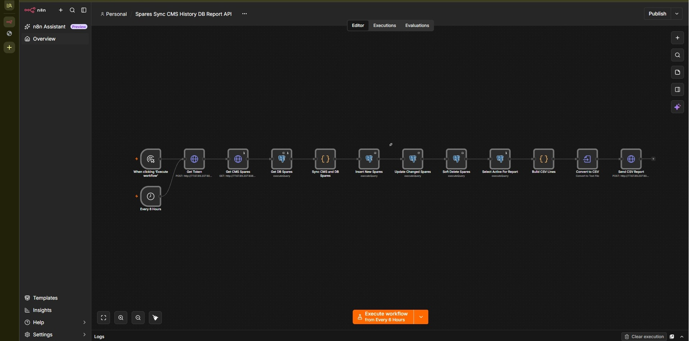
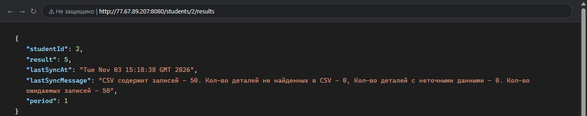

# Интеграционное приложение — Синхронизация данных CMS → БД → Report API

Работа по дисциплине «Интеграция систем».  
Реализовано с использованием **n8n** и **PostgreSQL**.

Спецификация API: http://77.67.89.207:8080/swagger-ui/index.html

## Описание проекта

Интеграционное приложение для синхронизации данных между тремя системами:

1. **CMS** (система управления контентом) — источник данных о деталях на складе
2. **PostgreSQL** — БД исторических данных (хранит все детали, включая удалённые)
3. **Report API** — система отчётности (принимает CSV-файлы)

### Архитектура

```
┌─────────┐    REST API     ┌──────────────┐    SQL      ┌────────────┐
│   CMS   │ ──────────────► │  N8N Workflow │ ──────────► │ PostgreSQL │
│  (API)  │  GET /cms/spares│  (интеграция) │  UPSERT    │   (БД)     │
└─────────┘                 └──────┬───────┘             └─────┬──────┘
                                   │                           │
                                   │   CSV                     │ SELECT
                                   ▼                           │
                            ┌─────────────┐                    │
                            │ Report API  │ ◄──────────────────┘
                            │ POST /report│   Формирование CSV
                            └─────────────┘
```

## Используемые технологии

| Компонент | Технология | Описание |
|-----------|-----------|----------|
| Интеграционная платформа | **n8n** | Open-source платформа автоматизации рабочих процессов |
| База данных | **PostgreSQL 15** | Реляционная СУБД для хранения исторических данных |
| Контейнеризация | **Docker Compose** | Оркестрация контейнеров |

## Структура проекта

```
├── .env.example         # Шаблон переменных окружения
├── .gitignore           # Исключения для Git
├── README.md            # Документация проекта
├── docker-compose.yml   # Конфигурация Docker (PostgreSQL + n8n)
├── docs/screenshots/    # Скриншоты workflow и результата
├── init.sql             # SQL-скрипт инициализации БД
└── workflow.json        # N8N workflow — основная логика интеграции
```

## Workflow



## Потоки данных

### Поток №1 — Синхронизация CMS → БД

1. N8N по расписанию (каждый час) запускает workflow
2. Получает Bearer-токен через `POST /auth/token`
3. Забирает все детали из CMS через `GET /cms/spares` (с пагинацией, по 10 штук)
4. Каждая деталь записывается в PostgreSQL через `UPSERT` (INSERT ... ON CONFLICT DO UPDATE)
   - Новые детали добавляются
   - Существующие обновляются (если данные изменились)
   - Удалённые из CMS детали **сохраняются** в БД (историчность)

### Поток №2 — Формирование отчёта БД → Report API

5. Из PostgreSQL выгружаются все исторические данные
6. Формируется CSV-файл (без заголовка, разделитель `;`, кодировка UTF-8)
7. CSV загружается в Report API через `POST /report/csv` с Bearer-авторизацией

### Формат CSV

```
spareCode;spareName;spareDescription;spareType;spareStatus;price;quantity;updatedAt
```

Пример строки:
```
SPARE-1;Spare Part 1;Description for spare part 1;BRAKE;RESERVED;22;29;2025-09-09T14:53:45.751668
```

## Описание узлов N8N Workflow

| Узел | Тип | Описание |
|------|-----|----------|
| Schedule Trigger | Триггер | Запуск каждый час |
| Get Bearer Token | HTTP Request | Получение токена авторизации |
| Fetch All CMS Pages | Code | Получение всех деталей из CMS с пагинацией |
| Upsert to PostgreSQL | PostgreSQL | Запись/обновление данных в БД |
| Read All from DB | PostgreSQL | Чтение всех исторических данных |
| Build CSV | Code | Формирование CSV-строки |
| Upload CSV to Report API | HTTP Request | Отправка CSV в Report API |

## Запуск

### Предварительные требования
- Docker и Docker Compose установлены

### Шаги запуска

```bash
# 1. Клонировать репозиторий
git clone https://github.com/elinakiztamum123-glitch/integration.git
cd integration

# 2. Создать .env файл
cp .env.example .env

# 3. Запустить контейнеры
docker-compose up -d

# 4. Открыть n8n в браузере
# http://localhost:5678

# 5. Импортировать workflow
# В n8n: Меню → Import from File → выбрать workflow.json

# 6. Настроить Postgres Credentials в n8n:
#    Host: postgres
#    Port: 5432
#    Database: integration_db
#    User: postgres
#    Password: postgres123

# 7. Запустить workflow вручную или дождаться автоматического запуска
```

## Результат



Проверка оценки: http://77.67.89.207:8080/students/2/results

## Автор

- **Student ID:** 2
- **Login:** student2

